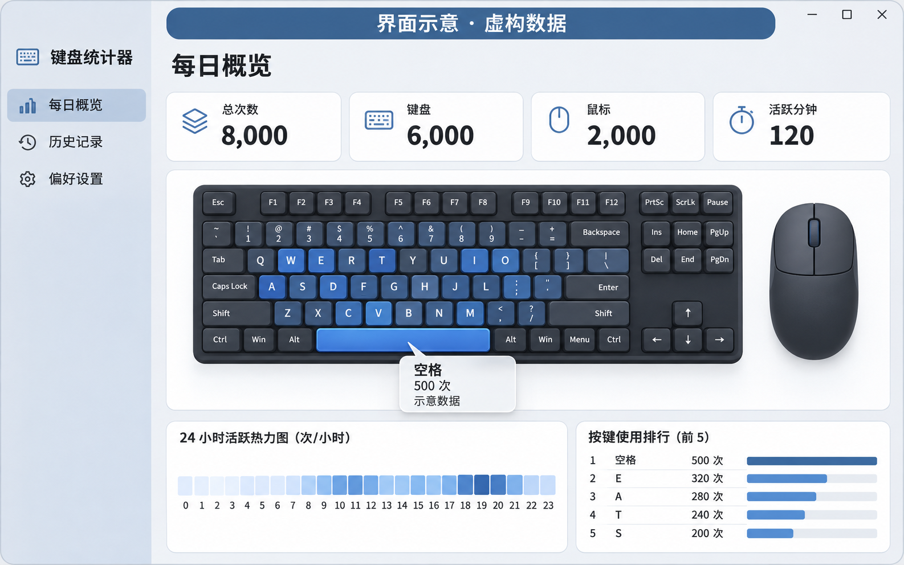
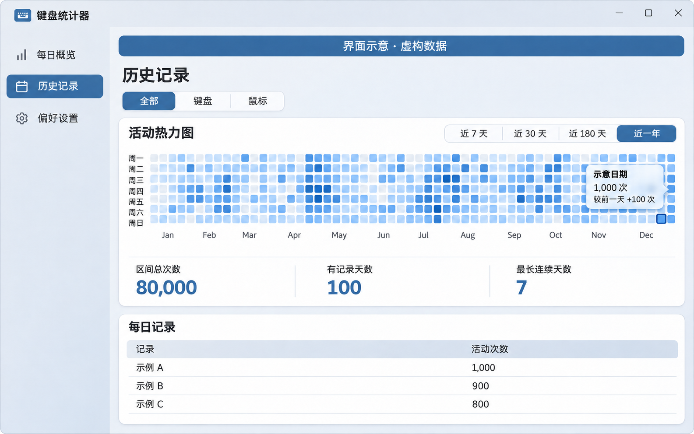

# 键盘统计器 · Keyboard Stats

一款离线运行的 Windows 键盘与鼠标使用统计工具。按本机日期记录按键次数，通过键鼠热力图、小时分布和历史活动查看自己的使用习惯。

使用 C#、.NET 10 和 WPF 构建，采用 MIT 许可证。当前版本为 **1.7.0**。

## 功能示意

每日概览支持小窗与最大化的一屏布局。键盘和鼠标模型会随可用空间等比缩放，悬停在按键上可查看跟随光标的磨砂玻璃统计卡片。



历史活动按周排列，支持近 7 天、近 30 天、近 180 天和近一年。今天始终在最右一列，日期浮窗显示次数和较前一天的变化。



以上两张图片由 AI 绘制，数值和活动分布均为虚构，用于说明功能。布局细节以实际软件为准。绘制要求见 [示意图说明](docs/images/README.md)。

## 功能

- 统计键盘按键和鼠标左键、右键、中键、两个侧键的使用次数。
- 区分左右 Ctrl、Shift、Alt、Win，以及主键盘和数字小键盘回车。
- 显示键鼠模型热力图、24 小时分布、常用键排行和活跃分钟。
- 通过搜索和分页查看数字小键盘、媒体键等全部已记录按键。
- 按周展示滚动活动热力图，根据所选区间内的相对次数分为六档蓝色。
- 按设备和日期筛选历史记录，导出带 UTF-8 BOM 的 CSV。
- 支持托盘后台运行、暂停与恢复、长按连发计数和可选的开机启动。
- 自动保存本机汇总数据，提供备份与损坏文件恢复机制。

## 下载与安装

在 [Releases](https://github.com/SoceroFalcone/keyboard-stats/releases) 下载 Windows x64 安装包，或下载包含安装包、使用说明和 SHA-256 校验码的分享 ZIP。

适用系统为 Windows 10 2004 或更新版本、Windows 11，处理器架构为 x64。发布版已包含 .NET 运行环境。安装向导支持选择目录及创建快捷方式，默认安装到当前账户。

1. 运行安装包，按中文向导完成安装。
2. 打开「键盘统计器」，程序开始统计正常桌面中的键鼠操作。
3. 关闭主窗口后，默认继续留在系统托盘运行。双击托盘图标重新打开，右键可暂停或退出。
4. 更新前从托盘正常退出，再运行新安装包。卸载时会保留统计记录和偏好设置。

当前安装包未做数字签名。首次运行会解压内置运行组件，启动可能稍慢。

## 使用

### 每日概览

使用日期栏切换今天、昨天或指定日期。顶部摘要分别显示键鼠总次数、键盘敲击、鼠标点击和活跃分钟。热力颜色越深，用量越高。

悬停键帽或鼠标部位可查看准确次数和占比，点击后会在模型下方保留详情。小时分布支持悬停或点击查看对应时段。「全部按键」提供搜索和分页。

### 历史记录

顶部切换「全部 / 键盘 / 鼠标」，会同步更新活动热力图和每日记录。

活动热力图的每一列代表一周，周一至周日从上到下排列。近 7 天、近 30 天、近 180 天和近一年均包含今天，其中近一年为最近 365 天。颜色根据所选区间内非零次数的相对大小分档，相同次数使用相同颜色。悬停日期可看当天用量和前日增减，点击可打开当天概览。

下方每日记录具有独立日期筛选，支持全部日期、今天、昨天、近 7 天、近 30 天及自定义范围。起止日期均包含在范围内。双击记录或选中后按 Enter 查看当天，导出按钮会导出当前筛选结果。

### 统计口径

- 默认每次实际按下记一次，长按产生的重复输入可在偏好设置中启用计数。
- 鼠标双击记两次。按住和拖拽只记最初按下的一次，中键指按下滚轮。
- 鼠标移动、滚轮滚动不会增加点击次数。
- 活跃分钟指当日发生过至少一次键盘敲击或鼠标点击的分钟数，同一分钟只计一次。
- Fn 等未向 Windows 发送独立键码的硬件键无法单独统计。模型中的 Fn 会显示说明。
- 数字小键盘和额外媒体键可在「全部按键」中查看。键鼠模型用于显示统计，不自动识别硬件型号。
- 中文输入法、快捷键和组合键均按实际按键统计，按键次数与字符数量可能不同。
- 应用退出、锁屏和安全桌面期间的输入无法记录，软件注入的输入默认忽略。远程桌面和特殊驱动的表现取决于 Windows 输入事件。

## 数据与隐私

数据保存在当前 Windows 账户的 `%LOCALAPPDATA%\KeyTrail`，可在偏好设置中打开。

```text
KeyTrail/
├── settings.json
├── settings.json.bak
└── days/
    ├── YYYY-MM-DD.json
    └── YYYY-MM-DD.json.bak
```

程序只保存每天的各键次数、每小时总量和活跃分钟，不保存输入文字、按键顺序、每次按键的精确时间、鼠标位置、应用名称或窗口标题。应用的统计功能离线运行，无账户、遥测和数据上传。

每 5 秒自动保存，正常退出立即保存。文件通过临时写入和原子替换更新，并保留上一次成功保存的备份。异常断电可能丢失最近约 5 秒的计数，备份可恢复至上次成功保存的状态。数据使用本地 JSON 文件，未加密。

备份或迁移时，先从托盘退出，再复制整个数据目录。CSV 中可能被表格软件解释为公式的字段会做转义。

## 从源码运行

需要 Windows 和 **.NET 10 SDK**。程序使用原生 WPF，当前支持 Windows x64。

```powershell
git clone https://github.com/SoceroFalcone/keyboard-stats.git
cd keyboard-stats
dotnet build KeyTrail.slnx -c Release
dotnet run --project src/KeyTrail.Desktop
```

项目没有第三方 NuGet 包依赖。托盘使用 Windows Forms，数据序列化使用内置 JSON API。

### 演示模式

演示模式使用独立数据目录，用于查看界面和生成截图。

```powershell
dotnet run --project src/KeyTrail.Desktop -- --demo --data-dir "./artifacts/demo"
```

请为演示模式指定空目录。演示窗口有明显标记，使用预置数据，运行时不安装键鼠监听。

其他启动参数包括 `--background`（从托盘启动）、`--data-dir <目录>`（指定数据目录）和 `--exit`（通知同一数据目录对应的实例正常退出）。

## 构建与测试

```powershell
# 核心计数、存储、恢复和 CSV 检查
dotnet run --project tests/KeyTrail.Tests -c Release -- artifacts/test-data

# 使用独立演示数据验证 WPF 布局和交互
dotnet run --project tests/KeyTrail.Preview -c Release -- artifacts/preview

# 发布包含运行环境的单文件程序
pwsh -File scripts/publish.ps1
```

单文件程序生成在 `dist/KeyTrail/KeyTrail.exe`，此后也可使用项目根目录的 `启动键盘统计器.cmd` 启动。

可选的原生监听测试需要交互式 Windows 桌面，命令为 `dotnet run --project tests/KeyTrail.Tests -c Release -- artifacts/test-data --native`。该测试发送无文字的 F24 测试键。

### 制作安装包

安装包使用 **Inno Setup 7** 和 **PowerShell 7** 构建。先安装 Inno Setup，再提供本机编译器路径。

```powershell
pwsh -File scripts/build-installer.ps1 -CompilerPath "C:\Tools\Inno Setup 7\ISCC.exe"
```

结果生成在 `release/<版本>/`，包括安装包、分享 ZIP、说明和校验码。详细流程见 [安装包文档](docs/INSTALLER.md)，测试范围见 [验证记录](docs/TESTING.md)。

## 项目结构

```text
src/KeyTrail.Core/        键码映射、计数、日期汇总、持久化与 CSV
src/KeyTrail.Desktop/     WPF 界面、原生监听、托盘与偏好设置
tests/KeyTrail.Tests/     核心逻辑及原生输入测试
tests/KeyTrail.Preview/   使用真实 WPF 控件的布局与交互验证
installer/               中文安装器脚本与随包说明
scripts/                 发布、安装包构建与本地验证
docs/                    设计、测试、性能与安装文档
```

生成的程序、安装包、测试数据和本机开发配置由 `.gitignore` 排除。安装包通过 Releases 分发。

## 参与贡献

欢迎提交 Issue 或 Pull Request。报告问题时请说明 Windows 版本、显示缩放比例、窗口尺寸、复现步骤和预期行为。截图中如有个人统计，可先遮盖。

修改计数或持久化逻辑后，请运行核心检查。修改界面后，请运行 WPF 预览检查，并查看小窗、最大化、空数据和筛选状态下的表现。

## 许可证与素材

项目采用 [MIT License](LICENSE)。

键盘和鼠标图像为基于参考图生成的可视化素材，图标由项目脚本绘制。素材来源、生成提示及处理方式见 [素材说明](src/KeyTrail.Desktop/Assets/PROVENANCE.md)。图片中的外形用于展示输入部位，项目与参考产品品牌无隶属关系。

发布版附带所用 .NET 和 Windows Desktop 运行时的第三方许可文件。系统字体由 Windows 提供。
